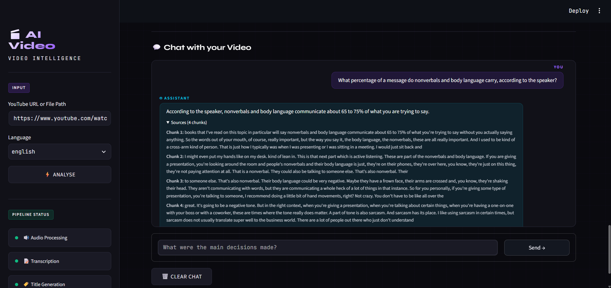
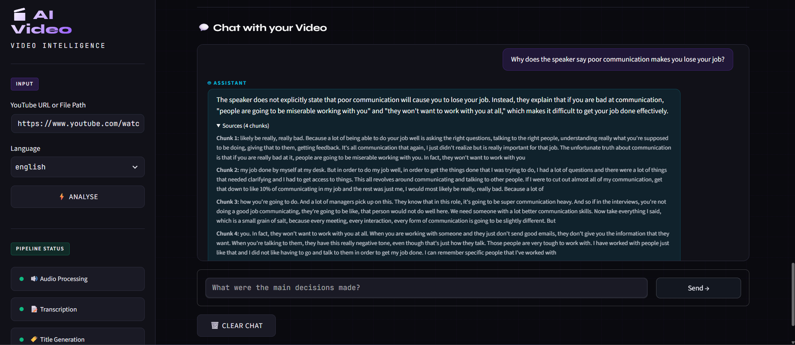

# AI Video Assistant

Paste a YouTube link and get a transcript, a summary with key takeaways, and a chat where every answer is grounded in the transcript and shows the exact chunks it came from.

```
YouTube URL -> yt-dlp + ffmpeg (audio) -> Whisper (english) / Sarvam AI (hinglish)
            -> transcript -> Gemini summary + extractions
            -> chunk (500 chars, 50 overlap) -> MiniLM embeddings -> Chroma
            -> top-4 retrieval -> Gemini answers only from the retrieved chunks
```

## Setup

Requirements: Python 3.10+ and [ffmpeg](https://ffmpeg.org/) on your PATH (it is not a pip package).

```bash
python -m venv .venv
.venv\Scripts\activate          # Windows
pip install -r requirements.txt
```

Python 3.13: `pydub` also needs `pip install audioop-lts`.

Create a .env file in the project root with:

```
GEMINI_API_KEY=
SARVAM_API_KEY=          # only needed for hinglish
WHISPER_MODEL=base       # tiny / base / small / medium
SARVAM_STT_MODEL=saaras:v2.5
```

## Run

```bash
streamlit run app.py
```

Paste a YouTube URL, choose the language, click Analyse, then ask questions in the chat. Each answer has a "Sources" expander showing the retrieved chunks.

## RAG design choices

| Choice | Value | Why |
|---|---|---|
| Chunk size / overlap | 500 chars / 50 | One idea per chunk keeps matches precise; overlap avoids losing sentences at boundaries. |
| Embeddings | `all-MiniLM-L6-v2` (local, 384 dims) | Free, no API key, matches meaning rather than keywords. |
| Vector store | Chroma | Simple local persistence. |
| Retrieval | similarity search, k = 4 | Starting default. |
| Answering | Gemini, "use only this context" prompt | Reduces hallucination. |

**Missing evidence:** if the retrieved chunks don't contain the answer, the model is instructed to reply "I could not find this information in the video transcript." Out-of-scope questions are part of the test set below.

## Evaluation

Sample video: **Communication in Data Roles | Soft Skills in Tech** by **Alex The Analyst**, used under the **Creative Commons Attribution license (CC BY)**: https://www.youtube.com/watch?v=pOWdsMPeRvo

Transcript generated by the app from the audio (Whisper) and not redistributed in this repo; run the app on the link above to reproduce the results.

13 hand-written questions, tested manually. "Retrieval" = the chunk containing the answer appeared in the 4 sources shown. Refusals are N/A for retrieval.

| # | Type | Question | Expected | Retrieval | Result |
|---|---|---|---|---|---|
| 1 | Direct | What share of getting the job done does the speaker say communication is? | About 50% | Hit | Correct |
| 2 | Direct | What ways of communicating in data roles does the speaker list? | Meetings, email/messaging, writing, dashboards, presentations | Hit | Correct |
| 3 | Direct | What did the speaker do wrong with eye contact, and what does he do now? | Looked down at slides; now scans the room and makes eye contact | Hit | Correct |
| 4 | Direct | What percentage of a message do nonverbals and body language carry? | About 65-75% (per books he cites) | Hit | Correct |
| 5 | Direct | How does the speaker practice active listening? | Notes, nodding, gentle smile | Hit | Correct |
| 6 | Direct | Why is sarcasm a problem at work? | Doesn't translate well to business; often misunderstood | Hit | Correct |
| 7 | Direct | What is the Jenny and Alex example about? | Sarcastic "you did great" implies she did not | Hit | Correct |
| 8 | Direct | What happens if you are really bad at communication? | People are miserable working with you and won't want to | Hit | Correct |
| 9 | Vague | What should I do when someone else is presenting? | Active listening: notes, nodding, smiling | Hit | Correct, minor over-extension |
| 10 | Vague | How can I sound more positive? | Watch tone, talk kindly, avoid sarcasm | Hit | Correct |
| 11 | False premise | Why does the speaker say poor communication makes you lose your job? | He doesn't say this; he says people won't want to work with you | Hit | Correct (did not confirm the premise) |
| 12 | Out of scope | What is the capital of France? | Refusal | N/A | Correct |
| 13 | Out of scope | Which programming language does the speaker recommend? | Refusal | N/A | Correct |

**Result:** 13/13 answered as expected. This is a small test (one video, questions written by me from the same transcript), so it shows the pipeline works but doesn't prove it generalizes. On Q9, retrieval was right but the answer blended advice for *presenting* with advice for *listening*.

**Limitations:** one video is indexed at a time (delete `vector_db/` and `transcript.txt` to switch videos); chunks can start mid-sentence; retrieval is plain similarity search (reranking and a larger automated eval are next steps).





## My Contribution

I built the end-to-end pipeline (audio -> transcript -> summary -> RAG chat), debugged
the retrieval and prompt issues, added source-chunk display, and wrote and ran the
evaluation above. I used tutorials and other references for the base pipeline and the
Sarvam integration, and AI tools for the Streamlit UI, which I treated as a display
layer for the RAG work.